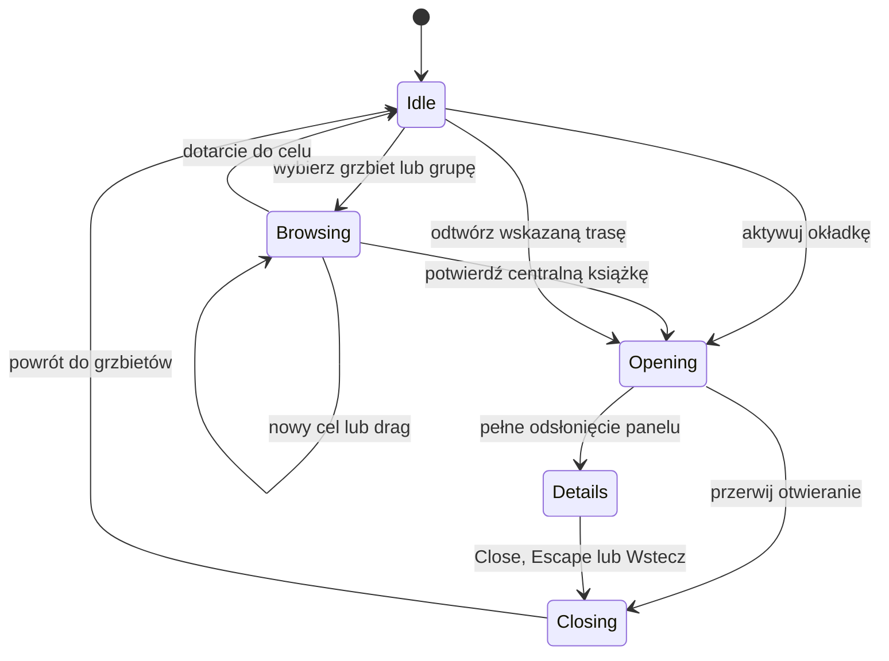

# Architektura

Półka to aplikacja statyczna. React tworzy interfejs i stabilne elementy sceny. Przeglądarka rzutuje bryły w CSS 3D. Kontroler aktualizuje ich macierze poza cyklem renderowania Reacta. W analizowanej referencji te same zadania wykonują DOM, CSS 3D, requestAnimationFrame i Web Animations. Pozwoliło to odtworzyć współrzędne bez wprowadzania osobnej kamery lub kontekstu WebGL.

| Obszar | Pliki | Odpowiedzialność |
|---|---|---|
| Katalog | src/data/personal-books.json, src/data/books.json, src/data/catalog.ts | Metadane, źródła, proporcje, wygląd grzbietów i nazwy kategorii |
| Scena | src/geometry/BookModel.tsx, ShelfScene.ts, pose.ts | Sześć powierzchni, układ cykliczny, projekcja, światło i odległość od środka |
| Materiały | src/styles/book.css, src/components/Cover.tsx | Przód z prawdziwą teksturą, oprawa tylna, trzy krawędzie stron, adnotacja awarii |
| Ruch | src/animation/ShelfController.ts | Jedno źródło pozycji, celu, zaznaczenia, fazy i głównej pętli animacji |
| Wejście | src/interaction/bindInputs.ts | Wskaźnik, dotyk, kierunek gestu, kółko, klawiatura, Escape i pułapka fokusu |
| Szczegóły | src/components/Details.tsx, src/animation/DetailMotion.ts | Maska od aktualnego rzutu okładki, animacja tekstu, informacje o wydaniu i przypisanie źródeł |
| Odsłonięcie ilustracji | Ink.ts, ink.worker.ts, inkField.ts | Siedem pól, mapa czasów dotarcia maski, ograniczenie rozdzielczości i zwalnianie buforów |
| Układ | src/components/Shelf.tsx, Header.tsx, src/styles | Responsywna scena, pasek kategorii z licznikiem, stały przycisk Open book, tryb kolorystyka portfolio |
| Indeks wydań | catalog.html, src/catalog-page.tsx, scripts/catalog.mjs | Dostęp do wszystkich książek, rzeczywiste filtrowanie i generowanie zestawienia źródeł |

## Przejścia i przerwania

Hover jest własnością pozy wybranej bryły. Nowe polecenie na półce zastępuje cel ruchu. Silnik startuje z aktualnej pozycji ułamkowej, więc wcześniejsze polecenia nie pozostawiają działających osobno animacji. Podczas zamykania przejście zaczyna się od aktualnej widoczności i granic maski. Jeżeli historia przeglądarki skieruje do innego tytułu podczas zamykania, kontroler położy poprzednią książkę na miejsce i obsłuży aktualny URL.

Najbliższe cykliczne wystąpienie tego samego tytułu ma ten sam model i dane przez cały przejazd. Klik centralnej książki mocuje panel do prostokąta jej przedniej płaszczyzny. Pod spodem pozostaje ta sama fizyczna bryła w tej samej pozycji. Szczegóły zawierają drugie wyświetlenie tej samej zweryfikowanej tekstury, odsłaniane stopniowo. Na desktopie okładka jest po lewej stronie, a opis po prawej. W pionowym układzie mobilnym okładka poprzedza opis. Powrót ponownie korzysta z rzeczywistych współrzędnych tej płaszczyzny. ResizeObserver przelicza wymiary sceny i punkt docelowy po zmianie orientacji.

## Materiał książek

Przy zerowym obrocie grzbiet jest zwrócony w kierunku dodatniego Z, a przednia i tylna okładka znajdują się przy przeciwnych końcach osi X. Górna, dolna i przednia krawędź bloku stron mają lekko cofnięte brzegi. Numeracja zachowuje kolejność mapy czytelniczej. Grzbiety mają własną oprawę typograficzną i kolory nawiązujące do publikacji. Tylne oprawy i krawędzie stron to rekonstrukcje materiału. W katalogu atrybucji oznaczenie autentycznego obrazu dotyczy przodu.

Scena żąda obrazu po wejściu modelu w obszar renderowania z zapasem na obu końcach. Identyczne adresy trzech cyklicznych wystąpień korzystają z pamięci podręcznej przeglądarki. Po zdekodowaniu zdjęcie trafia również bezpośrednio na transformowaną płaszczyznę. To pozwala kompozytorowi WebKit odświeżyć front obracanej bryły. Przy zimnym cache pięć zewnętrznych okładek zależy od odpowiedzi Open Library. Opóźnienie i awaria mają osobne komunikaty. Książka zachowuje numer, miejsce w rzędzie i link do źródła.

## Budżet renderowania i dostępność

- W spoczynku kontroler kończy pętlę requestAnimationFrame. Zdarzenie lub zmiana wymiarów wznawia ją. Instancje poza użytecznym zasięgiem mają ukryte powierzchnie. React aktualizuje opis przy zmianie aktywnego tytułu.
- Raster pomocniczy maski używa DPR do 1,5 i maksymalnie 320 pikseli szerokości. Rozdzielczość oryginalnej okładki jest niezależna od maski. Worker wstępnie wylicza czasy dotarcia plam, a mała pamięć podręczna zachowuje najwyżej dwa pola. Zniszczenie panelu zwalnia canvas i zatrzymuje worker.
- Wybór prefers-reduced-motion natychmiast ustawia położenie, pomija dekoracyjną maskę i przestrzenne śledzenie kursora. Bryły oraz ich głębia pozostają czytelne.
- Przy otwartym panelu reszta strony jest inert. Tab pozostaje w panelu, Escape go zamyka, a kontroler przywraca fokus. Półkę można obsłużyć z klawiatury, a czytnik ekranu informuje o wybranym tytule.
- Na urządzeniach dotykowych poziomy gest ma próg 8 px oraz rozpoznanie kierunku. Pionowy przesuw i gest anulowany przez przeglądarkę nie aktywują książki. Szczegóły mają własny przewijany obszar, a główna strona pozwala na zwykłe przewijanie, gdy brakuje wysokości.
